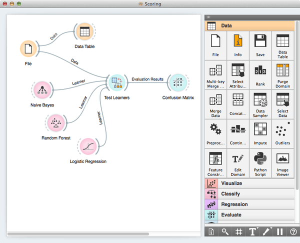
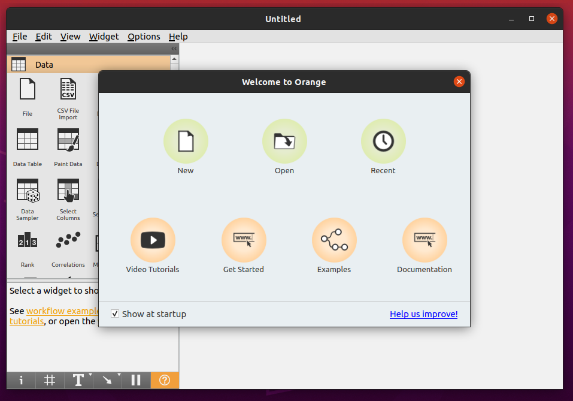
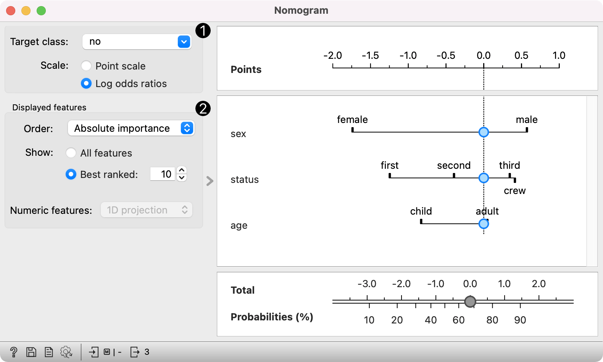

# Orange Data Mining Makes Data Exploration Visual

Orange Data Mining turns a dataset into a connected canvas of tables, plots, transformations, and learners. For orange 3 data mining workflows, the same selection of rows can become the subject of several views, helping you investigate a pattern before deciding how to model it.

[](https://orange-3-data-mining.github.io/Orange-Data-Mining/)

## Investigate a Selection Across Views

Connect File to Scatter Plot, then send the plot's Selected Data output to Data Table. Select a region of points and inspect the corresponding records.

This interaction is central to orange data mining: a visualization becomes an input to the next question. Change the axes, compare distributions, or inspect the records behind an apparent outlier.

- Use labels and variable names to keep the selection interpretable.
- Check whether the next widget receives all rows or only selected rows.
- Compare a selected group with the broader dataset before drawing conclusions.
- Keep exploratory selections separate from the data used for final evaluation.



The supplied [bench_datadelegate.py](benchmark/bench_datadelegate.py) measures table-view rendering operations. It provides implementation context for tabular interaction rather than an analysis workflow to copy.

## Decide What Each Column Means

A column can be an input feature, a prediction target, or descriptive metadata. Make those roles explicit before comparing learners or measuring distances.

Identifier columns may be useful for tracing records without belonging among predictive features. Numeric-looking category codes also deserve inspection before an algorithm treats them as measurements.

You can inspect the same distinction through the Orange Python library in an environment where Orange is already installed:

```python
from Orange.data import Table
data = Table("iris")
print("Rows:", len(data))
print("Features:", [v.name for v in data.domain.attributes])
print("Target:", data.domain.class_var.name)
```

The example uses Orange's bundled Iris dataset. The [data tutorial](https://orange3.readthedocs.io/en/latest/tutorial/data.html) explains domains, variables, and supported input formats.

For implementation details, [bench_domain.py](benchmark/bench_domain.py) exercises domain conversion, while [bench_transform.py](benchmark/bench_transform.py) covers table transformations. [bench_variable.py](benchmark/bench_variable.py) measures numeric value formatting.

### Prepare Values for the Question

Check missing values, category definitions, and measurement scales. A distance-based grouping can change substantially when one feature has a much larger numeric range than another.

The supplied [bench_preprocess.py](benchmark/bench_preprocess.py) benchmarks normalization and imputation-related operations. [bench_basic.py](benchmark/bench_basic.py) covers basic table access, loading, and other data operations.

For predictive evaluation, supply learned preprocessing through the learner or the Test and Score preprocessor input so it is fitted within the evaluation procedure.

## Explore Groups Without Supplying a Target

For orange data mining visualization, combine k-Means with Scatter Plot and Silhouette Plot. Cluster assignments describe groups formed from the selected features; they are distinct from any known class labels.

In k-Means, choose a fixed cluster count or compare a range using silhouette scores. Review the normalization setting and inspect poorly matched points before assigning a meaning to a group.

- Compare plausible cluster counts rather than treating the first result as definitive.
- Inspect cluster membership alongside the original measurements.
- Investigate negative silhouette values as possible signs of ambiguous assignments.
- Record the features and preprocessing used to produce the grouping.



[bench_owkmeans.py](benchmark/bench_owkmeans.py) contains performance cases for the k-Means widget with synthetic datasets. These cases measure widget behavior; they do not establish cluster quality for your data.

The [k-Means widget documentation](https://orangedatamining.com/widget-catalog/unsupervised/kmeans/) describes its outputs, initialization choices, and preprocessing.

## Evaluate Predictions Against the Intended Use

An orange data mining machine learning workflow needs a target and an evaluation design that matches the question. Send the dataset and several learners to Test and Score to compare them under the same procedure.

| Evaluation choice | How observations are used | Suitable purpose | Interpretation |
| --- | --- | --- | --- |
| Cross-validation | Each fold is held out in turn | Comparing candidates on one labeled dataset | An estimate across held-out folds |
| Random sampling | Repeated training and test splits | Examining variation across random splits | Results depend on split size and repetition |
| Separate test data | A distinct dataset supplies test cases | Checking performance on reserved observations | Keep it outside model selection |
| Test on training data | Fitted observations are scored again | Demonstrating fit | Does not estimate performance on unseen cases |

Connect Evaluation Results to Confusion Matrix to inspect which classes are confused. Accuracy alone can conceal differences that matter for a particular class.

When adding custom preprocessing, connect Preprocess to Test and Score to apply it within each training fold. Preprocessing the entire dataset before evaluation can leak information.

### Reproduce a Small Learner Comparison

This independent Python example compares two Orange learners on identical five-fold splits. It prints classification accuracy without assuming a particular numerical result:

```python
import Orange
data = Orange.data.Table("iris")
learners = [
    Orange.classification.LogisticRegressionLearner(),
    Orange.classification.RandomForestLearner(n_estimators=50, random_state=0),
]
results = Orange.evaluation.CrossValidation(data, learners, k=5, random_state=0)
print(Orange.evaluation.scoring.CA(results))
```

Consult the [classification tutorial](https://orange3.readthedocs.io/en/latest/tutorial/classification.html) for the distinction between learners, fitted models, and evaluation.



For custom modeling, [learners.ipynb](tutorials/learners.ipynb) demonstrates learner and model implementations. Its companion [README.md](tutorials/README.md) identifies the notebook's teaching purpose.

## Keep the Workflow Explainable

Save the canvas and retain the data needed to reproduce it. Record variable roles, preprocessing choices, learner settings, and evaluation conditions alongside the result.

Orange data mining software supports Python scripting as well as visual analysis. Use code when a repeated operation or a custom learner needs a more explicit definition.

With Orange and its GUI dependencies installed in the active Python environment, this command opens the canvas without the splash screen or welcome window:

```bash
python -m Orange.canvas --no-splash --no-welcome
```

This launches the desktop application; it does not execute a batch evaluation. The entry point is also recorded in the supplied Conda recipe, [meta.yaml](conda-recipe/meta.yaml).

### Extend the Analysis When the Data Requires It

Add-ons provide specialized widgets for text, networks, time series, and other domains. Check the relevant add-on documentation before assuming its widgets belong to the base application.

For an orange text mining task, identify the required text add-on and document its version with the workflow. A standard tabular workflow and a text-processing workflow can have different dependency requirements.

The supplied [create_widget_catalog.py](scripts/create_widget_catalog.py) generates widget-catalog material. It supports documentation production rather than performing data mining itself.

## Interpret the Included Performance and Project Records

Performance measurements answer narrower questions than model scores. [bench_save.py](benchmark/bench_save.py) tests table serialization-related operations; [base.py](benchmark/base.py) provides shared benchmark infrastructure.

Read timings in the context of dataset shape, representation, and environment. A benchmark on synthetic data does not predict the duration of every interactive analysis.

- [requirements-core.txt](requirements-core.txt) lists core runtime dependencies.
- [requirements-dev.txt](requirements-dev.txt) lists development tools.
- [pyproject.toml](pyproject.toml) declares build requirements and wheel-build settings.
- [MANIFEST.in](MANIFEST.in) specifies files included in source distributions.
- [pylintrc](pylintrc) configures Python linting.
- [codecov.yml](codecov.yml) defines coverage-reporting settings.

[CHANGELOG.md](CHANGELOG.md) records changes by release. [create_changelog.sh](scripts/create_changelog.sh) assembles release-note entries from Git history.

[CODE_OF_CONDUCT.md](CODE_OF_CONDUCT.md) defines community standards. [LICENSE](LICENSE) states the supplied software's GPL-3.0-or-later licensing terms.

The supplied files are a partial Orange project snapshot containing tutorials, benchmarks, and supporting configuration. The main application package is absent, so application commands and API examples require a separately installed Orange environment.

## Related Search Terms

orange 3 data mining, orange data mining, orange data mining software, orange data mining machine learning, orange data mining visualization, data-mining, data-science, data-visualization, machine-learning, visual-programming, classification, clustering, regression, python, orange3
